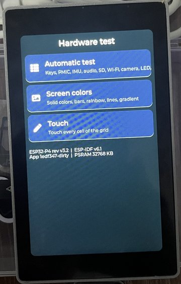
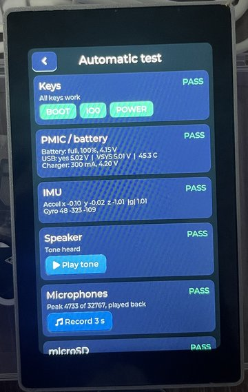
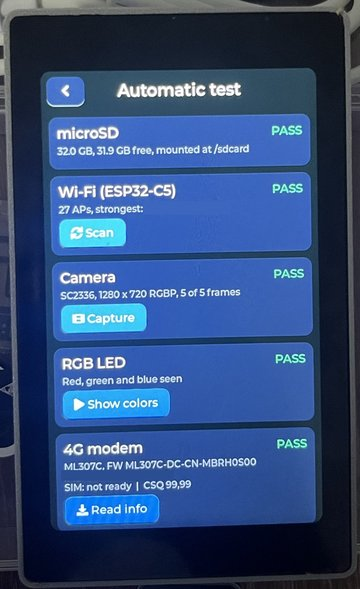
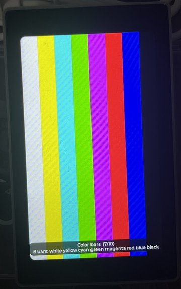
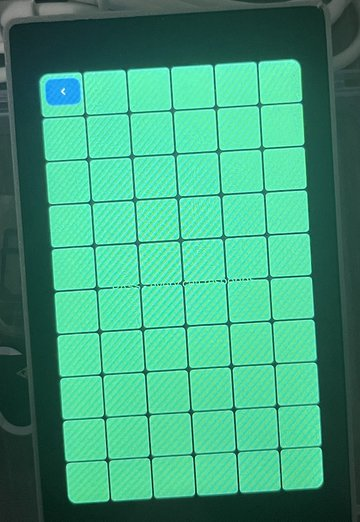

# BSP: Hardware test app

## Overview

One app to check the whole KSDIY ESP32-P4C5 board, with a PASS / FAIL result per part:

| Page | What it checks | BSP API used |
|---|---|---|
| Automatic test → Keys | BOOT, IO0 and the power key | `bsp_iot_button_create()`, `bsp_pmic_event_register()` |
| Automatic test → PMIC / battery | AXP2101: battery, fuel gauge, USB, VSYS, charger | `bsp_battery_get_info()` |
| Automatic test → IMU | LSM6DS3TR-C, gravity close to 1 g | `bsp_imu_init()`, `bsp_imu_read()` |
| Automatic test → Speaker / Microphones | ES8311 + speaker, ES7210 + mics (record and play back) | `bsp_audio_codec_speaker_init()`, `bsp_audio_codec_microphone_init()` |
| Automatic test → microSD | Mount (never formats) and size | `bsp_sdcard_mount()`, `bsp_sdcard_unmount()` |
| Automatic test → Wi-Fi | ESP32-C5 over ESP-Hosted, access point scan | `bsp_wifi_init()` |
| Automatic test → Camera | CSI sensor, frame capture through V4L2 | `bsp_camera_start()`, `bsp_camera_stop()` |
| Automatic test → RGB LED | WS2812B shows red, green, blue | `bsp_led_rgb_set()` |
| Automatic test → 4G modem | ML307C model, firmware, IMEI, SIM and signal over AT | `bsp_modem_init()`, `bsp_modem_at()`, `bsp_modem_deinit()` |
| Screen colors | Dead pixels, tint, banding | `bsp_display_start()` |
| Touch | Dead zones of the touch panel | LVGL input from `bsp_display_start()` |

| Menu | Automatic test | Automatic test (scrolled) |
|---|---|---|
|  |  |  |

| Screen colors | Touch |
|---|---|
|  |  |

Each part of the automatic test is one `main/item_*.c` file that only uses the BSP API, so the files also serve as usage examples.

For generic display, touch, audio and SD card examples, the esp-bsp examples can be built against this BSP.

## Build and Flash

```
idf.py -p {port} flash monitor
```
